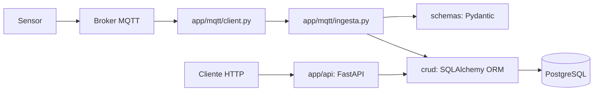

# API para adquisición, validación y consulta de datos IoT

Taller 2: FastAPI, MQTT y PostgreSQL. La guía original está en [GUIA.md](GUIA.md).

## 1. Información General

| Campo | Valor |
|---|---|
| Proyecto | API de mediciones IoT |
| Integrantes | Juan David Velasquez · **Pendiente: confirmar si hay un segundo integrante** |
| Asignatura | Aplicaciones y Servicios Web |
| Fecha | **Pendiente: fecha de entrega** |
| Sensor asignado | `GAS-002` (**confirmar**) |
| Tópico MQTT | `iot/sensors/GAS-002/data` |

## 2. Descripción del Sistema

### Problema resuelto

Un sensor publica mediciones JSON por MQTT, y el servicio puede enviar mensajes inválidos a
propósito. La aplicación los recibe, valida su estructura y su coherencia con el catálogo de la
base de datos, guarda únicamente los válidos y permite consultarlos mediante una API.

### Arquitectura



Un solo proceso (`uvicorn app.main:app`) ejecuta la API y, en un hilo aparte, el consumidor MQTT.

### Magnitudes y unidades

| Magnitud | Unidad | Tipo de dato |
|---|---|---|
| `ch4` | `ppm` | número |
| `temperature` | `C` | número |
| `humidity` | `%` | número |

Los rangos válidos se leen de la tabla `sensor_magnitudes`; no están escritos en el código.

### Payload del sensor

Estructura observada en `GAS-002` en una captura del 9 de octubre de 2026 (**pendiente:
confirmar con una captura nueva**):

```json
{
  "sensor_id": "GAS-002",
  "timestamp": "2026-10-09T02:53:58Z",
  "measurements": {
    "ch4": { "value": 569.47, "unit": "ppm" },
    "temperature": { "value": 27.69, "unit": "C" },
    "humidity": { "value": 84.29, "unit": "%" }
  }
}
```

`sensor_id` corresponde a `sensores.codigo` (no a `sensores.id`). `timestamp` es texto ISO 8601
en UTC.

### Reglas de validación

Un mensaje se guarda solo si **todas** sus magnitudes superan todas las reglas. Cada magnitud
queda como un registro en `mediciones`, con el mismo `timestamp_utc`, en una sola transacción.

| Regla | Motivo registrado al rechazar |
|---|---|
| JSON en UTF-8, sin claves repetidas | `JSON_INVALIDO` |
| Campos obligatorios, sin campos extra, tipos estrictos (`"780.24"`, `true`, `null` y `NaN` no son números) | `ESTRUCTURA_O_TIPO_INVALIDO` |
| Timestamp ISO 8601 en UTC y fecha real | `TIMESTAMP_INVALIDO` |
| El sensor existe | `SENSOR_INEXISTENTE` |
| El sensor coincide con el del tópico | `SENSOR_NO_COINCIDE` |
| El sensor está activo | `SENSOR_INACTIVO` |
| La magnitud pertenece al sensor | `MAGNITUD_INVALIDA` |
| La unidad es exactamente la configurada | `UNIDAD_INCORRECTA` |
| `valor_minimo <= valor <= valor_maximo` | `VALOR_FUERA_DE_RANGO` |

## 3. Configuración del Entorno

Requiere Python 3.10 o superior. En PowerShell, desde la raíz del proyecto:

```powershell
python -m venv .venv
```

```powershell
.venv\Scripts\Activate.ps1
```

```powershell
pip install -r requirements.txt
```

```powershell
Copy-Item .env.example .env
```

Completa `.env` (no se sube al repositorio):

| Variable | Descripción |
|---|---|
| `DB_HOST`, `DB_PORT`, `DB_NAME`, `DB_USER`, `DB_PASSWORD` | Conexión PostgreSQL entregada por el docente |
| `MQTT_BROKER`, `MQTT_PORT`, `MQTT_TOPIC` | Broker y tópico asignado |
| `MQTT_USERNAME`, `MQTT_PASSWORD` | Solo si el broker los exige |
| `MQTT_KEEPALIVE` | Segundos de keepalive (60) |
| `MQTT_ENABLED` | `false` para iniciar la API sin consumir MQTT |
| `LOG_FILE` | Registro de mensajes (`logs/mqtt.log`) |

Verificar la conexión, ver mensajes y ejecutar:

```powershell
python -m app.database.connection
```

```powershell
python mqtt_example.py
```

```powershell
uvicorn app.main:app
```

La documentación interactiva queda en <http://127.0.0.1:8000/docs>.

### Pruebas automáticas

Usan SQLite en memoria: no tocan la base ni el broker del curso. No reemplazan las evidencias
con datos reales.

```powershell
python -m pytest -q
```

## 4. Base de Datos

La conexión se arma en [app/database/connection.py](app/database/connection.py) con SQLAlchemy y
el controlador `psycopg`, a partir de variables de entorno. La aplicación **no crea ni modifica
tablas**, y sobre el catálogo (`sensores`, `sensor_magnitudes`) solo hace consultas.

| Tabla | Modelo | Uso |
|---|---|---|
| `sensores` | `Sensor` | Lectura |
| `sensor_magnitudes` | `SensorMagnitud` | Lectura |
| `mediciones` | `Medicion` | Lectura e inserción |

Relaciones: `sensores` 1:N `sensor_magnitudes` 1:N `mediciones`, con claves foráneas
`ON UPDATE CASCADE ON DELETE RESTRICT`. Los modelos reflejan los tipos, restricciones únicas,
`CHECK` e índices de [data-model.md](data-model.md).

## 5. Organización del Código

| Carpeta | Función |
|---|---|
| `app/schemas/` | Pydantic: payload MQTT, respuestas y conversión a hora de Colombia (`tiempo.py`) |
| `app/models/` | Modelos ORM, uno por tabla |
| `app/crud/` | Consultas por tabla; la única escritura es insertar mediciones |
| `app/api/` | Endpoints y códigos HTTP |
| `app/mqtt/` | `client.py` (conexión y registro) e `ingesta.py` (validación y almacenamiento) |
| `app/database/` | Engine y sesiones |

## 6. Endpoints Implementados

| Método | Ruta | Descripción |
|---|---|---|
| GET | `/sensores` | Lista los sensores |
| GET | `/sensores/{id}` | Sensor por ID |
| GET | `/sensores/por-codigo/{codigo}` | Sensor por código |
| GET | `/sensores/{id}/magnitudes` | Magnitudes de un sensor |
| GET | `/sensor-magnitudes/{id}` | Magnitud configurada por ID |
| GET | `/mediciones/{id}` | Medición por ID |
| GET | `/sensores/{id}/mediciones` | Histórico; filtros `magnitud`, `desde`, `hasta`, `limit` |
| GET | `/sensores/{id}/ultima-medicion` | Registro más reciente; filtro opcional `magnitud` |

- El histórico se ordena de lo más reciente a lo más antiguo; `limit` (1 a 10000) cuenta
  registros, no mensajes.
- `desde` y `hasta` son inclusivos. Sin zona horaria se interpretan como hora de Colombia; en una
  URL, el `+` de un desfase debe escribirse `%2B`.
- Las fechas se responden como `AAAA-MM-DD HH:MM:SS -05:00`.
- Un filtro `magnitud` sin coincidencias devuelve una lista vacía.

| Código | Cuándo |
|---|---|
| 200 | Consulta correcta |
| 400 | `desde` posterior a `hasta` |
| 404 | El recurso no existe, o no hay mediciones para la última medición |
| 422 | Parámetro con tipo o formato inválido |
| 503 | Base de datos no disponible |

## 7. Evidencias de Funcionamiento

Ver [evidencias/README.md](evidencias/README.md).

## 8. Control de Versiones

- Repositorio: <https://github.com/juandavidvelasquezgomez/servicios_web/tree/taller-2>
- Historial: `git log --oneline`
- Aporte de cada integrante: **Pendiente de completar por el equipo.**
- Los commits creados con ayuda de un asistente de IA lo indican en la línea `Co-Authored-By`.

## 9. Conclusiones

**Pendiente de redactar por el equipo** después de ejecutar la recolección:

- Principales aprendizajes.
- Dificultades encontradas.
- Soluciones aplicadas.
